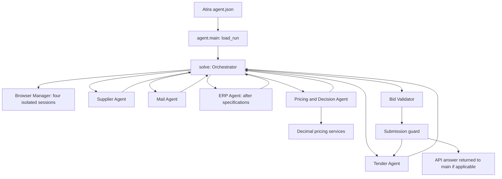

# Atira RFQ modular agent skeleton

This project extends the official EHL starter kit with six logical agents: the Orchestrator and five workers.
It establishes integration contracts and local test infrastructure. Website investigation, complete commercial
pricing, business validation and signed submission are intentionally unfinished. Production exits with blocked
statuses and no answer. A skeleton is not expected to score or pass review as a completed challenge solution.

The integration follows the official [getting started guide](https://ehl-challenge.atira.ai/start),
[RFQ rules and answer schema](https://ehl-challenge.atira.ai/challenges/rfq),
[run contract](https://ehl-challenge.atira.ai/docs/run-contract.md), and
[manifest requirements](https://ehl-challenge.atira.ai/docs/submitting.md), read on 10 October 2026.
The runtime brief and `answer_schema` remain authoritative; no scenario answers, URLs or credentials are built in.

## Architecture



All arrows between workers are routed through the Orchestrator. The first stage runs Tender, Supplier and Mail
concurrently; ERP receives the resulting technical specifications, then Pricing receives all available outputs.
A worker may return partial data or be blocked/failed. The coordinator preserves available typed output, records
errors and missing questions, and routes a bounded number of targeted requests. No business decision is inferred
from a worker's success status alone.

`Planner.stages()` is the extension point for future scheduling; a model-driven planner can replace the current
deterministic stages. Runtime navigation and important decisions must be model-directed once implemented.
The coordinator owns state mutations on the event loop and gives each task a deep typed snapshot. Agent results
have a discriminated output union, so JSON round trips retain their exact type. `on_event` receives progress events.

## Modules and contracts

| Path | Purpose |
| --- | --- |
| `agent.py`, `agent.json` | Preserved entry point and manifest; `solve(task, page)` delegates to the Orchestrator |
| `run.py`, `browsers.py`, `models.py` | Original platform adapters, unchanged |
| `core/contracts.py` | Tasks, results, statuses, evidence, tender/specification/ERP/policy/bid models |
| `core/config.py`, `core/state.py`, `core/events.py` | Configuration, in-memory state and progress event boundary |
| `core/orchestrator.py` | Registration, concurrent/dependent stages, deadlines, retries and reinvestigation |
| `agents/base.py`, `agents/{tender,supplier,erp,mail,pricing}.py` | Async worker interface and production placeholders |
| `agents/mock.py` | Explicit synthetic workers using the same contracts |
| `tools/browser_manager.py`, `tools/navigation.py` | Session ownership and runtime observation helper |
| `tools/llm_client.py` | Injectable async model client, structured output, tool calls, usage and bounded retries |
| `services/` | Matching/policy protocols, Decimal pricing boundary, validation and submission |
| `prompts/` | Future worker prompt guidance; implementations must explicitly load these files |
| `tests/` | New architecture tests and retained starter-kit tests |

Every worker implements `BaseAgent.execute(AgentTask, AgentContext) -> AgentResult` and has a unique identifier.
Context supplies the original runtime run, assigned page, injected model client and configuration. Tender submission
is a distinct `submit` task; targeted follow-ups use `reinvestigate` with a question. Agents never call peers.
`None` means unknown, while `Decimal("0")` represents a known zero. Provenance can name the source site, document,
reference, revision, field, observation and applicable time. Tokens use `SecretStr`, are excluded from serialization,
and must never be included in evidence excerpts or logs. Do not dump runtime contexts, which contain credentials.

Run state retains tender/specification/ERP/commercial records, evidence, statuses, results, missing information,
errors, pricing, validation and submission receipt. Revision authority, conflicts and per-position readiness must
be implemented using these records; the skeleton does not pretend to resolve them.

## Browser and model integration

The manifest requests exactly four browsers with `"browsers": 4`. The Browser Manager uses the original
`browsers.connect` and discovered `CDP_URLS`/`CDP_URL`, assigning indices 0–3 to Tender, Supplier, ERP and Mail.
It reuses the page supplied to `solve` for Tender. It rejects missing/duplicate sandbox endpoints, gives workers
only their assigned page, and retains browser lifecycle ownership. Agents must not close pages' parent browsers
or contexts. Local sessions are closed by their owners; sandbox Chromium is never closed by workers/manager:
Playwright disconnects when its scope exits and Atira owns browser shutdown. No standalone browser is launched
by the new integration when a run token is present without managed CDP endpoints.

`LLMClient()` lazily wraps `models.qwen()` and defaults to the kit's `models.QWEN_MODEL`; agents share this client.
`ask(system, user, output_type=SomePydanticModel, tools=...)` returns text, typed output, tool calls and usage.
A caller can inject an existing async OpenAI-compatible SDK client and model name, preserving provider/proxy
configuration from the runtime environment. Original `models.ask_qwen` and `models.ask_clef` remain usable.
Native providers such as Clef retain their original adapter; no authentication is reimplemented. Only transient
connection, timeout, 408/429 and 5xx failures are retried (default once, maximum three). Invalid structured output
is surfaced; unsupported structured-output features should be handled explicitly by future agents. SDK retries
are disabled for the owned client. For injected clients, configure SDK retries to zero yourself. The coordinator's
timeout also bounds model calls; tune it for model latency and the remaining run time.

`RunConfig` defaults: production mode, 120 seconds per task/resource/submission, one worker retry, two
reinvestigation rounds and a 60-second deadline reserve. Retry only results explicitly marked retryable; exceptions
receive a generic error to avoid leaking runtime secrets. Cancellation propagates and resource cleanup runs.
Tune these options through dependency injection. `ATIRA_MODE` accepts only `production` or `mock`; unknown values fail.

## Safe mock workflow and verification

Install dependencies (Python 3.12+ and uv):

```sh
uv sync --locked
uv run --no-sync python -m unittest discover -s tests -v
uv run --no-sync python -m core.orchestrator
```

The last command is an offline wiring demonstration using synthetic empty records and fake session objects.
It requires no browser, model keys, scouting credentials or network. It simulates a Tender submission receipt,
never calls a real site/API, and records an invalid synthetic bid. It does not calculate any commercial answers.
The original HTTP adapter tests (with fake CDP endpoints added to the entry-point fixture) use temporary localhost servers; they require permission to bind localhost,
but no external account or live API. Architecture tests use fake browsers and injected model clients.

`ATIRA_MODE=mock uv run --no-sync python agent.py` also exercises the preserved lifecycle if scouting/run metadata
is already available. It still loads the run via `run.load_run`, then sanitizes the task and skips browser connection.
For entirely offline use, prefer the module demo above. Production is the default, including sandbox runs. Mock
agents are rejected in production; mock results/evidence are refused as genuine output. The submission guard
only simulates with a mock tender and synthetic bid. `solve` returns `None` for every mock workflow.

The pricing service returns an explicitly incomplete `BidResult`; material matching and policy resolution raise
`NotImplementedError`. The validator checks structural shape, provenance, duplicate positions and arithmetic,
and **always blocks real submission until challenge-wide business validation is implemented**. Replace that explicit
incomplete check with tested validation of the actual rules; do not simply remove it to send a dummy bid.
The submission interface requires valid genuine evidence and a signing token; the Tender implementation must return
a confirmed receipt. Never automatically retry the signing action after an ambiguous response; first check whether
a receipt exists. API answers are mapped to the documented schema (`material_number`, `lead_time_weeks`, EUR,
optional breakdowns omitted if unknown) and returned to `main`, which retains `run.submit_answer`. Decimal is used
for calculations with explicit HALF_UP; conversion to JSON numbers occurs only at the transport boundary.

The pricing workstream must implement all runtime rules independently: final quantities and units, current revisions
and scoped amendments, derived strokes, active-material matching, date/scale/price-unit/FX selection, authorized
conditional discounts and clauses, metal-index windows, ordinary/shared setup and allocation, carton packaging,
project bonus bands and cent allocation, shared stock and delivery commitments, final prices and totals.
Rounded reporting breakdowns must never feed back into the final-price formula. No rules are approximated here.

After local checks, run the real sandbox yourself from this directory:

```sh
atira test-run .
# Equivalent explicit challenge selection:
atira test-run . --challenge rfq
```

No real sandbox test was executed during scaffolding. Local checks do not establish sandbox compatibility or a
challenge score. This skeleton will exit without an answer until the production implementations are completed.

## Three developer workstreams

| Developer | Owned modules | Next implementation |
| --- | --- | --- |
| 1 | `core/orchestrator.py`, `agents/tender.py`, `services/submission.py`, `tools/browser_manager.py` | Model-directed tender/Q&A investigation, amended quantities, bid form and TAN signing/receipt; orchestration improvements |
| 2 | `agents/supplier.py`, `agents/erp.py`, `tools/navigation.py` | Revision-aware technical extraction and selected-document/table handling; narrow ERP search, exact active attributes and conditions |
| 3 | `agents/mail.py`, `agents/pricing.py`, pricing/matching/policy/validation services | Authorized date/reference policies, signing-token retrieval; deterministic pricing rules and decision/validation tests |

Shared ownership: coordinate changes to `core/contracts.py`, `agents/base.py`, configuration, model adapter,
manifest and dependencies before changing a field or interface. Add optional fields with provenance rather than
passing undocumented dictionaries. Keep worker-specific tests and prompts alongside each workstream.

To replace a mock worker, implement the corresponding production class using `execute`, consume only its assigned
page, and return the matching typed output (`TenderData`, `TechnicalRequirements`, `ERPData`, `CommercialPolicies`,
`BidResult`). Use `partial`/`blocked` with `MissingInformation` for targeted questions. Register a replacement through
`Orchestrator(..., agents={...})`, keeping all five unique worker IDs. Production defaults already instantiate the
production classes. Test against injected fake resources before live scouting, then implement business validation
and real Tender submission before enabling a complete run. Orchestrator is the sixth logical agent, not a second
worker registration.

## Original starter-kit development instructions

The sections below retain the platform setup, scouting, model and environment reference.

## The hosted models in short

Both are free and need no key of yours: runs get the variables, and locally `atira scout --env` sets them, pointed
at `atira models proxy`.

```python
import models

text = await models.ask_qwen("Which button submits this form? ...")          # QWEN_BASE_URL, QWEN_API_KEY
yes = await models.ask_clef({"page": page_text}, "Is this the current revision?")  # CLEF_BASE_URL, CLEF_API_KEY
```

`models.qwen()` is an OpenAI SDK client, for tool calls, images and everything else. Clef is set only where the
platform hosts it; if your agent relies on it, list `"models": ["qwen", "clef"]` in `agent.json` so the run waits for
it to warm up. Another provider works with your own key through the run's metering proxy:
`$API/docs/run-contract.md#llm-calls`.

## Run it locally

You need [uv](https://docs.astral.sh/uv/getting-started/installation/) (open a new terminal after installing it, so
it is on your PATH) and the Atira CLI, signed in once with `atira login`.

Terminal 1: start the free models and leave it open.

```sh
atira models proxy
```

Terminal 2, in this folder:

```sh
uv sync && uv run playwright install chromium
eval "$(atira scout --env)"     # the scouting logins, and the model variables pointed at that proxy
uv run --no-sync python agent.py
```

In PowerShell on Windows, Terminal 2:

```powershell
uv sync; uv run playwright install chromium
atira scout --env | Out-String | Invoke-Expression    # the same exports
uv run --no-sync python agent.py
```

A Chromium window opens (`HEADLESS=1` hides it). Nothing done with the scouting logins counts, and locally an answer
is printed, never submitted. If `atira` says `Unknown command: models`, run `atira upgrade`.

## Test-run it, then submit it

```sh
atira test-run .   # the sandbox, exactly like a scored run, on the public dataset; opens the run page live
atira submit .     # reviewed, then run once and scored for the leaderboard
```

Both pack this directory without what `.gitignore` excludes.

## Environment

| Variable | Set by | Used for |
| --- | --- | --- |
| `CHALLENGE_API_URL`, `CHALLENGE_RUN_TOKEN` | runs | the run, at `/v1/runs/current` |
| `CHALLENGE_SCOUTING` | `atira scout --env` | locally: the brief and the scouting logins |
| `CDP_URL`, `CDP_URLS` | runs | the sandbox's browsers; locally the kit starts its own Chromium |
| `QWEN_BASE_URL`, `QWEN_API_KEY` | runs, `atira scout --env` | the hosted Qwen |
| `CLEF_BASE_URL`, `CLEF_API_KEY` | runs, `atira scout --env`, when Clef is hosted | the hosted Clef |

## Docs

- How a run works: `$API/docs/run-contract.md`
- Building an agent: `$API/docs/building-an-agent.md`
- Fair play, the rules: `$API/docs/fair-play.md`

## Tests

```sh
uv run python -m unittest discover -s tests
```
