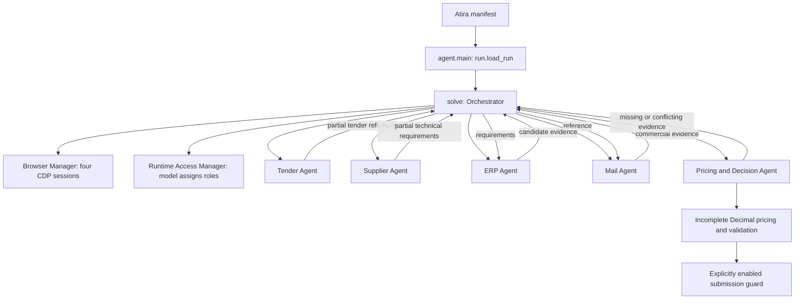

# Atira RFQ multi-agent website integration

This project keeps the official Atira entry point and modular architecture while replacing production placeholders
with model-directed authentication and investigation of the four runtime websites. Production gathers evidence
from the active execution; it has no mock data, scenario fixtures or scripted website click paths.

Full commercial pricing, authority/business validation, signing-TAN retrieval and signed Tender submission remain
incomplete. Successful investigation is not a successful commercial bid. With those features unfinished, the
application exits without an answer and Atira will classify the run as **no answer** even when investigation works.

The official [RFQ rules](https://ehl-challenge.atira.ai/challenges/rfq),
[getting started](https://ehl-challenge.atira.ai/start),
[run contract](https://ehl-challenge.atira.ai/docs/run-contract.md), and
[agent requirements](https://ehl-challenge.atira.ai/docs/building-an-agent.md) were reviewed on 10 October 2026.
The runtime brief and `answer_schema` are authoritative. The earlier skeleton was tested in Atira; **this real
investigation implementation has not yet been tested against live Atira websites or the hosted model**.

## Execution and module boundaries



`solve(task, page)` still accepts the original Atira run and browser-1 page. `run.py`, `browsers.py`, `models.py`,
manifest setup/run commands, four-browser request and model proxy configuration remain intact. `main()` still owns
API answer transport; real RFQ submissions will use the Tender website and return `None` after a confirmed receipt.

| Module | Purpose |
| --- | --- |
| `core/access.py` | Validate the four runtime access entries and dynamically assign business roles |
| `core/orchestrator.py` | Concurrent execution, partial results, event-based dependencies, retries and deadlines |
| `core/contracts.py`, `core/state.py`, `core/config.py`, `core/events.py` | Typed contracts, in-memory evidence/state and lifecycle configuration |
| `agents/website.py` | Shared real authentication, investigation, citation verification and partial-result publication |
| `agents/tender.py` | Tender/reference/position/Q&A/document objective |
| `agents/supplier.py` | Applicable technical revision/specification objective |
| `agents/erp.py` | Narrow model-directed candidate/material/price/stock objective |
| `agents/mail.py` | Exact-reference authorized commercial message objective |
| `agents/pricing.py` | Evidence readiness/conflict checks and targeted questions; incomplete pricing service |
| `tools/navigation.py` | Observed-target browser actions and bounded DOM/frame/tab observations |
| `tools/documents.py` | One selected PDF, DOCX, text/HTML/CSV/XML/JSON or ZIP member |
| `tools/browser_manager.py`, `tools/llm_client.py`, `tools/logging.py` | Existing browser/model wrappers and allowlisted structured diagnostics |
| `services/` | Preserved matching, policy, Decimal pricing, validation and submission boundaries |
| `prompts/` | Worker objectives and authority/document-investigation guidance |
| `tests/fakes.py` | Isolated fake resources; never imported by production modules |
| `tests/` | Runtime parsing, browser allocation, navigation, auth/extraction, dependency and original-adapter tests |

The former `agents/mock.py`, production mock selection, fake browser manager and offline mock demo were removed.
`ATIRA_MODE=mock` and `ATIRA_MODE=test` are rejected by the real entry point. A directly injected `RunConfig(mode="test")`
is only for unit-test workers; it creates no default fake agents and cannot submit.

## Access, authentication and browser control

`run.load_run()` continues to load either `/v1/runs/current` with the run token or `CHALLENGE_SCOUTING` locally.
`AccessManager` parses the run's `access` first; if that field is absent it accepts the same JSON array from
`CHALLENGE_SITE_ACCESS`. Each entry must supply `siteId`, an HTTP(S) URL and username/password credentials. Invalid
or incomplete access fails safely. There are no default website URLs, credentials or CDP endpoints.

The shared model client assigns the supplied entries to Tender, Supplier, ERP and Mail using the runtime brief,
entry IDs, URLs and descriptions. Assignments must uniquely use all four supplied entries; IDs and software may
change in the private dataset. Browser indices remain business roles: 0 Tender, 1 Supplier, 2 ERP, 3 Mail.

The original CDP connector is reused. Environment shape and four distinct endpoint URLs are validated before
connection. Browser ownership and cleanup stay centralized. In a token-bearing sandbox, missing CDP endpoints
never cause a standalone browser launch. Local scouting can launch four independent browsers through the original
connector. No worker closes a parent browser; Playwright disconnects and Atira owns managed Chromium shutdown.

All four workers open and authenticate their assigned sites concurrently. Authentication decisions use current
UI observations, not fixed login selectors. The model requests username/password fills using named secret references;
Python inserts the credentials into an observed field after checking site/form origin. Actual values are redacted
from model input, source excerpts, labels and diagnostic output. Successful authentication requires model-confirmed
visible application content and absence of a visible password login control; subsequent expired sessions reuse the
same bounded login loop. This verification heuristic needs live testing on each website implementation.

The navigation loop observes visible controls, bounded text, same-site frames, tabs and downloads. The model chooses
one typed operation: inspect, click, fill, select, press, scroll, back, follow an observed URL, switch tab, read a
selected document or finish. Actions cannot supply JavaScript or arbitrary selectors. Locators prefer uniquely
observed semantic labels/roles, falling back to the current generic control index, and recheck element identity
before executing. Only observed URLs and targets are accepted. Requests leaving the assigned site's origin are
blocked, including cross-site form destinations. Actual cross-origin SSO/document hosts therefore require an explicit,
reviewed runtime allowlist extension; the current implementation reports failure rather than leaking credentials.

A document helper reads only a URL/download chosen by the model. ZIP contents are listed first; the model selects
a member. Downloads, archive entries, expanded sizes and PDF pages have limits. Document chunks can be revisited
by offset without downloading again. Scanned PDFs requiring OCR, visual-only canvases and unsupported binary formats
are not implemented; those sources must be reported incomplete. There is no automatic website traversal or catalogue
crawler. Each model call receives bounded observations rather than entire HTML documents.

## Evidence and incremental coordination

Complete status also requires basic role-specific field coverage; missing required facts downgrade completion to partial.
Workers can publish a typed partial extraction using an `inspect` action with selected observation source IDs.
Extraction requires exact quoted excerpts from sources observed in this execution; invented IDs/quotations and
synthetic flags are rejected. The application assigns website, URL, document, observation time and agent provenance.
Records retain unknown values as `None`, including unknown discounts and stock. Known zeroes remain `Decimal("0")`.
Repeated extraction includes previous results and sources so the model can consolidate rather than forget progress.
Citations prove that a document/page was observed; business applicability and complete field correctness still need
business validation and real-runtime evaluation. Model extraction must not be treated as deterministic proof.

`AgentContext.report(result)` publishes through the coordinator, which alone mutates shared state on the event loop.
`get_task(task)` supplies a deep typed snapshot. Mail waits for a verified tender reference and ERP waits for technical
requirements; they can proceed as soon as those partial results arrive, before Tender/Supplier finish. Missing or
finished unsuccessful dependencies unblock waits and produce explicit blocked investigations rather than guesses.
Pricing receives the four genuine evidence-bearing outputs and requests missing/conflicting sources through the
coordinator. Follow-up investigations reuse the same run's page and selected-document cache; no state persists across
separate runs. Full position/material matching and authority/policy resolution remain developer work.

Contracts now include document references, Q&A identifiers/withdrawals/scoped revision information, source URLs,
conflict lists, original lead-time units, technical extra attributes and commercial reference/authority/date fields.
Agent interfaces retain `execute(AgentTask, AgentContext) -> AgentResult`. Signing-token retrieval has a separate
`retrieve_signing_token` task action, currently returning blocked without accessing TAN messages.

Logs are JSON lines with event, logical agent, operation/status, counts, elapsed time and exception class.
They cover browser readiness, runtime role resolution, authentication, navigation, extraction, dependencies and
completion. Values, URLs, raw model responses, exception messages, credentials, cookies and TANs are not logged.
Use event names such as `authentication_succeeded`, `evidence_extracted`, `tool_error`, `partial_result`,
`agent_finished` and `run_error` to diagnose progress. Application-generated observation IDs are logged for correlation; quoted source/business values remain in shared state.

Defaults: 300 seconds per worker/resource/submission, 12 authentication steps, 40 investigation actions, 10-second
browser action timeout, 12,000 visible text characters per observation, one retry for explicit retryable failures,
two follow-up rounds, and a 60-second deadline reserve. Worker timeouts respect remaining `expires_at` time.
Configure limits by injecting `RunConfig`; bounded retries and cancellation preserve available partial evidence.

`ATIRA_ENABLE_SUBMISSION=1` is the explicit future submission gate. Leave it unset for integration testing. Even if set,
submission remains blocked by the unfinished pricing/business-validation/TAN/Tender implementations. No dummy bid
or fabricated signing token is generated. `Decimal` and explicit HALF_UP helpers and the documented API answer mapping
remain unchanged. Complete pricing rules must be implemented and validated before enabling actual submission.

## Local verification and first real integration test

Install Python 3.12+ and uv, then from this directory:

```sh
uv sync --locked
uv run --no-sync python -m unittest discover -s tests -v
```

Fake browser/model clients exercise the actual production agent classes and navigation contracts. The original
HTTP adapter tests use localhost-only servers; no external model, website, credentials or challenge run is needed.
Synthetic records exist only in those isolated tests. Tests cover input parsing, arbitrary runtime role assignments,
secret redaction, login failure, action validation, observed targets, citation anchoring, partial/dependent execution,
no production fallback, incomplete pricing, and disabled submission.

When you choose to spend sandbox resources, start the first real integration test manually:

```sh
atira test-run . --challenge rfq
# The default challenge invocation also works:
atira test-run .
```

Use the returned run ID:

```sh
atira logs RUN_ID --follow
atira status RUN_ID --json
```

Check setup completes, four browser sessions initialize, four unique runtime sites resolve, and each logical agent
logs `authentication_succeeded`. Check `browser_action`, `evidence_extracted` and `partial_result` events prove
model navigation/extraction reached the coordinator; inspect role statuses and missing/error events. Examine browser
recordings to verify searches/documents correspond to the runtime objective and each worker owns a separate browser.
Expect pricing/submission to remain incomplete and the final run to be classified **no answer**. That does not
establish commercial correctness. If login/navigation or structured-output support fails, fix the observed issue
rather than adding static scenario values or scripted click paths. No live test was run automatically in this phase.

Unverified runtime assumptions: Qwen accepts the generated JSON-schema response format; role descriptions/brief
contain enough information for mapping; the private sites expose inspectable DOM content on the assigned origin;
authentication can be confirmed by visible application state; selected document text and navigation fit configured
limits; model extraction identifies governing revisions and records correctly. Local fake tests do not establish these.

## Development workstreams

| Developer | Owned modules | Next tasks |
| --- | --- | --- |
| 1 | Orchestrator, Tender, submission and browser lifecycle | Validate real Tender investigation/Q&A coverage; improve readiness/deadline scheduling; implement bid form, receipt checking and explicitly enabled signing |
| 2 | Supplier, ERP and material discovery | Validate current-revision/doc/table coverage; amended/derived requirements; exact active-material matching, selected candidate records and complete quantity-scale/stock attributes |
| 3 | Mail, Pricing and deterministic services | Validate exact-reference/sender/date/supersession rules; complete commercial policies and Decimal pricing/business validation; add requested-only TAN retrieval |

Coordinate changes to shared contracts, navigation, access, model wrapper, manifest and dependencies. Implement
worker-specific domain policies/prompts and tests without duplicating authentication or browser/model plumbing.
Do not replace `solve`, runtime loading, proxy credentials or result transport with another execution path.

## Original starter-kit platform reference

## The hosted models in short

Both are free and need no key of yours: runs get the variables, and locally `atira scout --env` sets them, pointed
at `atira models proxy`.

```python
import models

text = await models.ask_qwen("Which button submits this form? ...")          # QWEN_BASE_URL, QWEN_API_KEY
yes = await models.ask_clef({"page": page_text}, "Is this the current revision?")  # CLEF_BASE_URL, CLEF_API_KEY
```

`models.qwen()` is an OpenAI SDK client, for tool calls, images and everything else. Clef is set only where the
platform hosts it; if your agent relies on it, list `"models": ["qwen", "clef"]` in `agent.json` so the run waits for
it to warm up. Another provider works with your own key through the run's metering proxy:
`$API/docs/run-contract.md#llm-calls`.

## Run it locally

You need [uv](https://docs.astral.sh/uv/getting-started/installation/) (open a new terminal after installing it, so
it is on your PATH) and the Atira CLI, signed in once with `atira login`.

Terminal 1: start the free models and leave it open.

```sh
atira models proxy
```

Terminal 2, in this folder:

```sh
uv sync && uv run playwright install chromium
eval "$(atira scout --env)"     # the scouting logins, and the model variables pointed at that proxy
uv run --no-sync python agent.py
```

In PowerShell on Windows, Terminal 2:

```powershell
uv sync; uv run playwright install chromium
atira scout --env | Out-String | Invoke-Expression    # the same exports
uv run --no-sync python agent.py
```

A Chromium window opens (`HEADLESS=1` hides it). Nothing done with the scouting logins counts, and locally an answer
is printed, never submitted. If `atira` says `Unknown command: models`, run `atira upgrade`.

## Test-run it, then submit it

```sh
atira test-run .   # the sandbox, exactly like a scored run, on the public dataset; opens the run page live
atira submit .     # reviewed, then run once and scored for the leaderboard
```

Both pack this directory without what `.gitignore` excludes.

## Environment

| Variable | Set by | Used for |
| --- | --- | --- |
| `CHALLENGE_API_URL`, `CHALLENGE_RUN_TOKEN` | runs | the run, at `/v1/runs/current` |
| `CHALLENGE_SCOUTING` | `atira scout --env` | locally: the brief and the scouting logins |
| `CDP_URL`, `CDP_URLS` | runs | the sandbox's browsers; locally the kit starts its own Chromium |
| `QWEN_BASE_URL`, `QWEN_API_KEY` | runs, `atira scout --env` | the hosted Qwen |
| `CLEF_BASE_URL`, `CLEF_API_KEY` | runs, `atira scout --env`, when Clef is hosted | the hosted Clef |

## Docs

- How a run works: `$API/docs/run-contract.md`
- Building an agent: `$API/docs/building-an-agent.md`
- Fair play, the rules: `$API/docs/fair-play.md`

## Tests

```sh
uv run python -m unittest discover -s tests
```
